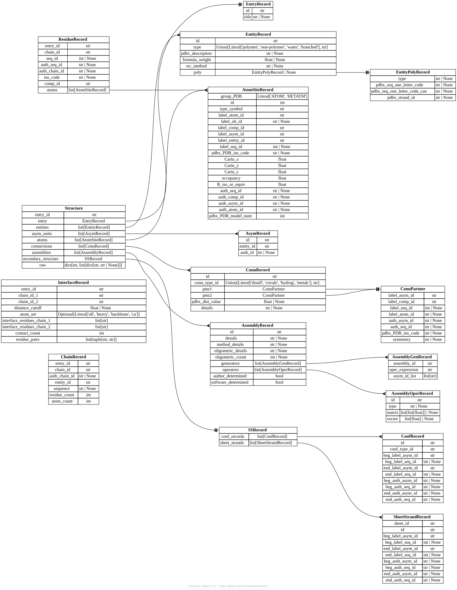
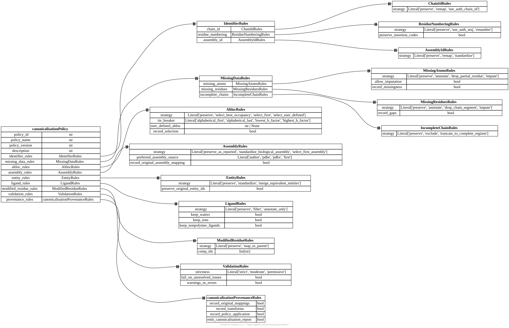
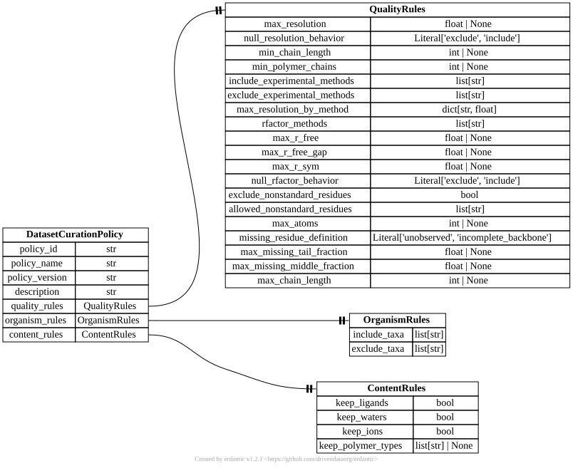
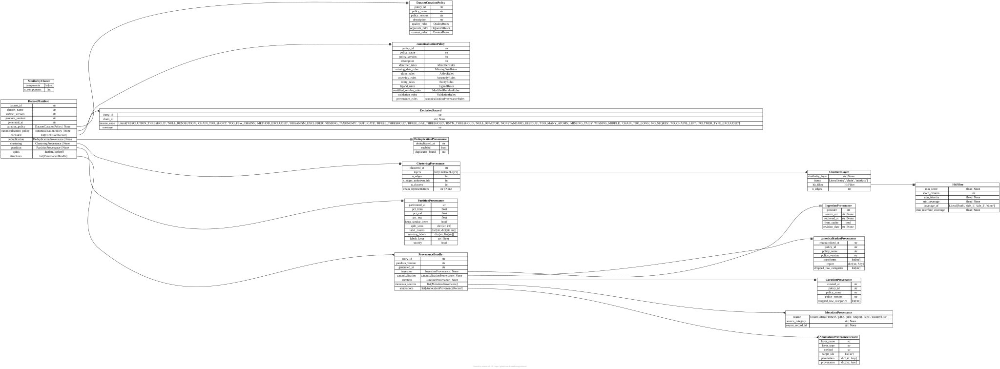

# Architecture

Pandora (see [Home](../index.md)) is a toolkit of plain functions and typed
models that you combine as your dataset needs. The *data* those functions
pass around is what actually defines the library's shape. This page has two
parts: a table mapping each component's functions to the models they take and return, then entity-relationship
diagrams showing how those models reference each other. The diagrams are
generated straight from the models' type hints via
[erdantic](https://erdantic.drivendata.org/), so they can never drift from
the code. Regenerate them after changing a model:

```sh
uv run --extra docs python docs/scripts/generate_erd.py
```

For per-field descriptions, see [Schemas](../reference/schemas.md); for full
signatures and docstrings, see [Functions](../reference/functions.md).

## Functions and the models they move

Every function below is pure: it takes a `Structure` (or another typed
model) in and returns a new one, never mutating its input. Types are
narrowed for readability — optional/keyword arguments and provenance-only
parameters are omitted; follow a function's link in
[Functions](../reference/functions.md) for the exact signature. Every
`pandora <subcommand>` in the CLI wraps exactly one function below,
reading/writing the same types as files instead of in-memory objects — see
[Library vs. CLI](../usage/overview.md#library-vs-cli).

### Ingestion

| Function | Takes | Returns |
|---|---|---|
| `fetch_mmcif()` | `entry_id`, `provider`, `output_dir` | `IngestionProvenance` — writes the mmCIF file as a side effect |
| `fetch_list_mmcif()` | a list of `entry_id`s | `list[IngestionProvenance]` — calls `fetch_mmcif()` once per id |
| `ingest_local_mmcif()` | `path` to a file already on disk | `IngestionProvenance` — describes it without fetching/copying |
| `load_policy()` | `path` to a policy YAML, optional policy `model` | `canonicalisationPolicy`, or an instance of `model` |
| `read_entry_paths()` | `path` to a text file of mmCIF paths | `list[Path]` |
| `write_entry_paths()` | `paths`, `path` of the text file to write | `None` |
| `template_entry_paths()` | archive `root`, path `template` with `{id}`/`{mid}`, optional `ids` | `list[Path]`, sorted |
| `mirror_path()` | mirror `root`, a file stem (entry id as spelled, e.g. `10kz` or `10kz_A`), `suffix` | `Path` `root/<mid>/<stem><suffix>` |
| `list_mirror_files()` | mirror `root`, `suffix` | `list[Path]`, sorted |

### Parsing

| Function | Takes | Returns |
|---|---|---|
| `mmcif_to_structure()` | `path_to_mmcif` | `(Structure | None, DiagnosticBundle, ResultStatus)` — the framework's central data model |

### Canonicalisation

| Function | Takes | Returns |
|---|---|---|
| `canonicalise_structure()` | `Structure`, [`canonicalisationPolicy`](#canonicalisation-policy) | `(Structure, CanonicalMappings, canonicalisationProvenance)` |
| `chain_copy_records()` | canonical `Structure`, `CanonicalMappings` | `list[ChainCopyRecord]`, one per symmetry-copy chain still in the structure (mmCIF has no field for it) |
| `filter_ligands()` | `atoms`, `asym_units`, `entities`, `LigandRules` | `(atoms, asym_units)` filtered — one of `canonicalise_structure()`'s nine internal rule steps, also callable on its own |

### Metadata

| Function | Takes | Returns |
|---|---|---|
| `collect_metadata()` | `Structure` | `MetadataRecord` — entry/quality/taxonomy/entity/ligand/UniProt records, all source-backed |

`collect_metadata()` is a thin wrapper over the `extract_*()` functions in
`pandora.metadata.mmcif` (one per record type); call those directly if you
only need one piece. See [Metadata](../usage/metadata.md).

### Annotations

| Function | Takes | Returns |
|---|---|---|
| `annotate_ligand_contacts()` | `Structure` | `list[ResidueContactRow]` (a `residue_contacts` layer) |
| `annotate_chain_interfaces()` | `Structure` | `list[ResidueContactRow]` (a `residue_contacts` layer) |
| `count_residue_contacts()` | `list[ResidueContactRow]` | `list[LayerRow]` (a `residue_values` layer) |
| `count_chain_contacts()` | `list[ResidueContactRow]` | `list[LayerRow]` (a `chain_values` layer) |
| `drop_labelled_interfaces()` | `list[ResidueContactRow]`, `interface_labels` rows, drop labels | `list[ResidueContactRow]` (the kept rows) |
| `count_interface_labels()` | the same | `dict[str, int]` (interfaces in, dropped, unlabelled; labels unmatched) |

The contact functions return the same `ResidueContactRow` rows that `annotate import` stores for another tool's contacts, so everything that reads contacts takes either; see [Annotation](../usage/annotation.md#contacts-are-one-layer).

### Datasets

| Function | Takes | Returns |
|---|---|---|
| `curate_structure()` | `Structure`, `MetadataRecord | None`, `DatasetCurationPolicy` | `(Structure | None, list[ExclusionRecord], CurationProvenance)` — `None` structure means excluded; records also cover removed chains |
| `chain_completeness()` | `Structure`, `MissingResidueDefinition` | `(list[ChainCompleteness], DiagnosticBundle)` |
| `deduplicate_structures()` | `list[Structure]`, `DeduplicationRules` | `(list[Structure], list[ExclusionRecord], DeduplicationProvenance)` |
| `find_contained()` | entry → chain counts per cluster, entry → rank values, `list[RankKey]` | `list[ContainmentRecord]`: the entries contained in another |
| `extract_chain_records()` | `Structure` | `list[ChainRecord]` |
| `dataset_chain_records()` | `Structure`, `MetadataRecord \| None`, `MissingResidueDefinition`, `copy_of`, `structure_path` | `list[DatasetChainRecord]`: `ChainRecord` + completeness + method/resolution + path + `copy_of` |
| `extract_residue_records()` | `Structure` | `list[ResidueRecord]` |
| `extract_interface_records()` | `Iterable[ResidueContactRow]`, `distance_cutoff`, `atom_set` | `list[InterfaceRecord]` — one per polymer chain pair in any `residue_contacts` layer |
| `interface_residue_pairs()` | `Iterable[ResidueContactRow]` | `dict[(entry_id, chain_1, chain_2), set[(res_1, res_2)]]` — the polymer–polymer pairs behind `extract_interface_records()` |

### Similarity

| Function | Takes | Returns |
|---|---|---|
| `compute_sequence_similarity()` | sequences (`dict[str, str]`, `list[ChainRecord]`, or a FASTA directory), `hits_path` | `LayerDescription` of the chain-level similarity layer; MMseqs2's hit TSV is written to `hits_path` |
| `compute_structure_similarity()` | structure file paths, `hits_path` | `LayerDescription`; Foldseek's hit TSV is written to `hits_path` |
| `read_hit_tsv()` | a tool's hit TSV, `engine` | `Iterator[pyarrow.RecordBatch]` in the `similarity` template's columns |
| `read_similarity_table()` | a Parquet or TSV similarity table | `Iterator[pyarrow.RecordBatch]` |
| `entry_items()` / `chain_items()` / `interface_items()` | entry IDs / `(entry, chain)` pairs / contact rows | `ItemSet`: the items a layer may name |
| `match_similarity_batches()` | record batches, `ItemSet` | `Iterator[(matched, unmatched)]` record batches |
| `similarity_edges()` | record batches of a similarity layer, `HitFilter` | `Iterator[Edge]`: streamed, filtered rows |
| `interface_similarity()` | `residue_contacts` rows, chain `SimilarityCluster`s, sequences by `(entry, chain)`, `min_identity` | `(list[LayerRow], dict[str, int])`: rows of an interface-level `similarity` layer (per-side Jaccard, `score` = smaller side) and counts |
| `entry_edges()` | chain-item edges | `Iterator[(entry_id, entry_id)]`: the roll-up to entries |
| `interface_edges()` | chain-item edges, interface item ids | `Iterator[(interface_id, interface_id)]`: the roll-up to interfaces |
| `cluster_edges()` | `item_ids`, any iterable of `(id, id)` pairs | `(list[SimilarityCluster], ClusteringProvenance)` |
| `restrict_clusters()` | `list[SimilarityCluster]`, item ids | `list[SimilarityCluster]` holding only those items |
| `cluster_hit_counts()` | `list[SimilarityCluster]`, any iterable of `(id, id)` pairs | `dict[str, int]`: partners per item inside its own cluster |
| `pick_representatives()` | `list[SimilarityCluster]`, item → rank values, `RepresentativePolicy`, optional eligible ids | `list[RepresentativeCluster]` |
| `item_labels()` | rows of a `chain_labels` / `interface_labels` layer, the template | `dict[str, str]`: item ID → label |
| `partition_dataset()` | `list[SimilarityCluster]`, optional `labels` (item ID → label) | `(dict[str, list[str]], PartitionProvenance)` — the `train`/`val`/`test` split, whole clusters per side; with `labels`, per-split label counts and the labels missing from a split |

### Provenance

| Function | Takes | Returns |
|---|---|---|
| `build_provenance_bundle()` | one `Structure` + whatever ingestion/canonicalisation/curation/metadata/annotation provenance you already have | `ProvenanceBundle` |
| `build_dataset_manifest()` | policies + every stage's provenance record above, plus a `ProvenanceBundle` per retained structure | `DatasetManifest` |
| `build_step_summary()` | step name, the policy it ran with, `input`, `output`, `started_at`, `counts`, `previous_summary` | `StepSummary` (the step's recipe; write with `write_json()`) |
| `canonicalisation_entry_record()` | canonical `Structure`, `canonicalisationProvenance`, `structure_path` | `CanonicalisationEntryRecord` (flat row for `write_records()`) |
| `curation_entry_record()` | curated `Structure`, `MetadataRecord \| None`, `CurationProvenance`, `structure_path` | `CurationEntryRecord` (flat row for `write_records()`) |
| `canonicalisation_provenance_from_record()` | `CanonicalisationEntryRecord` | `canonicalisationProvenance` (inverse of `canonicalisation_entry_record()`) |
| `curation_provenance_from_record()` | `CurationEntryRecord` | `CurationProvenance` (inverse of `curation_entry_record()`) |
| `reproduce_dataset()` | a `DatasetManifest` | `(dict[str, Structure], DatasetManifest)` — replays every recorded step from just the manifest |

### Export

| Function | Takes | Returns |
|---|---|---|
| `structure_to_mmcif()` | `Structure` | an mmCIF file |
| `export_chain_mmcif()` | `Structure`, `chain_id` | an mmCIF file with only that chain's atoms/connections |
| `write_fasta()` | `dict[str, str]` of id to sequence | a FASTA file |
| `write_json()` | any pydantic `BaseModel` (e.g. a `DatasetManifest`) | a JSON file |
| `write_records()` | a `Sequence[BaseModel]` (e.g. `list[ChainRecord]`) | a JSON or Parquet file |
| `read_records()` | a `.jsonl`/`.json`/`.parquet` file + the record model | `list[model]` (Parquet nulls as `None`) |

## The parsed molecule

`mmcif_to_structure()` (`pandora.parsing`) turns a raw mmCIF file into a
`Structure` — the framework's central data model. Every later stage
(`canonicalise_structure()`, `collect_metadata()`, the `annotate_*()`
functions, `structure_to_mmcif()`) takes a `Structure` in and, where it
transforms one, returns a new `Structure` rather than mutating in place.
`pandora.datasets.extract_*_records()` reshapes a canonical `Structure`
into flatter, ML-friendlier views (`ChainRecord`, `ResidueRecord`,
`InterfaceRecord`) for export.



## Canonicalisation policy

`canonicalise_structure()` runs nine rule groups in a fixed order — chain
IDs, residue numbering, assemblies, entities, missing data, altlocs,
ligands, then validation — each configured by one rules sub-model bundled
into a single `canonicalisationPolicy`. This tree is exactly what a
policy YAML file (see [Policies](../reference/policies.md)) deserializes into.



## Dataset curation policy

`curate_structure()` filters a canonical `Structure` by quality (resolution per method, R-factors, experimental method, residue content, size, missing residues, chain length), source organism, and non-polymer content — governed by a much smaller `DatasetCurationPolicy`. Chain rules remove failing chains rather than the whole entry.



## Provenance and the dataset manifest

Every stage produces its own provenance record; `build_provenance_bundle()`
collects one structure's worth (`ProvenanceBundle`) and
`build_dataset_manifest()` aggregates dataset-wide provenance —
curation, deduplication, clustering, partitioning — plus every retained
structure's bundle into one `DatasetManifest`, the single JSON file that
`reproduce_dataset()` can later replay from. The `canonicalisationPolicy`
and `DatasetCurationPolicy` boxes below are the same models diagrammed
above, shown collapsed here to keep this diagram readable.



## Standalone models

A few models aren't pictured because they don't reference — or get
referenced by — any other schema:

- **`AnnotationLayer`** (`pandora.schemas.annotation`) is the live result
  returned by each `annotate_*()` function; only its lighter-weight
  sibling `AnnotationProvenanceRecord` (pictured above, under
  `ProvenanceBundle`) gets persisted into a manifest.
- **`Diagnostic`/`DiagnosticBundle`** (`pandora.schemas.common`) carry
  parsing/canonicalisation warnings and errors; they're threaded through
  as function arguments, not stored on any other model.
- **`FetchOptions`** (`pandora.schemas.ingestion`) configures one
  `fetch_mmcif()` call and isn't retained afterward — only its result,
  `IngestionProvenance`, is.
- **`IngestionDiscovery`** (`pandora.schemas.ingestion`) records how
  `pandora ingest` found an archive's files; it is stored only as the
  `policy` of the `ingestion.json` step summary.
